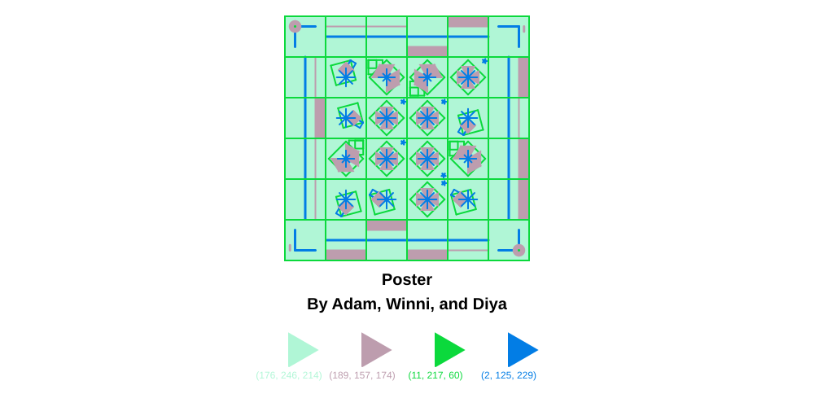

# Poster Generator

## About the Project

This project is a generative poster creator made using Python and ColabTurtlePlus. It creates unique geometric posters using randomly selected tile designs, different grid sizes, and customizable color palettes.

Users can choose a title, grid dimensions, and a color palette. The program then generates a unique poster.

## Group Members

- Adam
- Winni
- Diya

## How to Run

The project can be run using Google Colab.

Copy and run the following code in a Colab notebook:

```python
!git clone https://github.com/diyasata/Poster-generator.git
%cd Poster-generator
!pip install -r requirements.txt

from project import generate_poster

generate_poster()
```

## Project Files

- `project.py` – Main program that generates the poster.
- `PaletteOptions.py` – Contains the available color palettes.
- `TileFunctions.py` – Contains the functions used to draw the poster tiles.
- `requirements.txt` – Lists the required Python library.

## Example Poster

An example of the generated poster will be displayed here.
